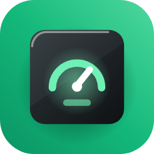
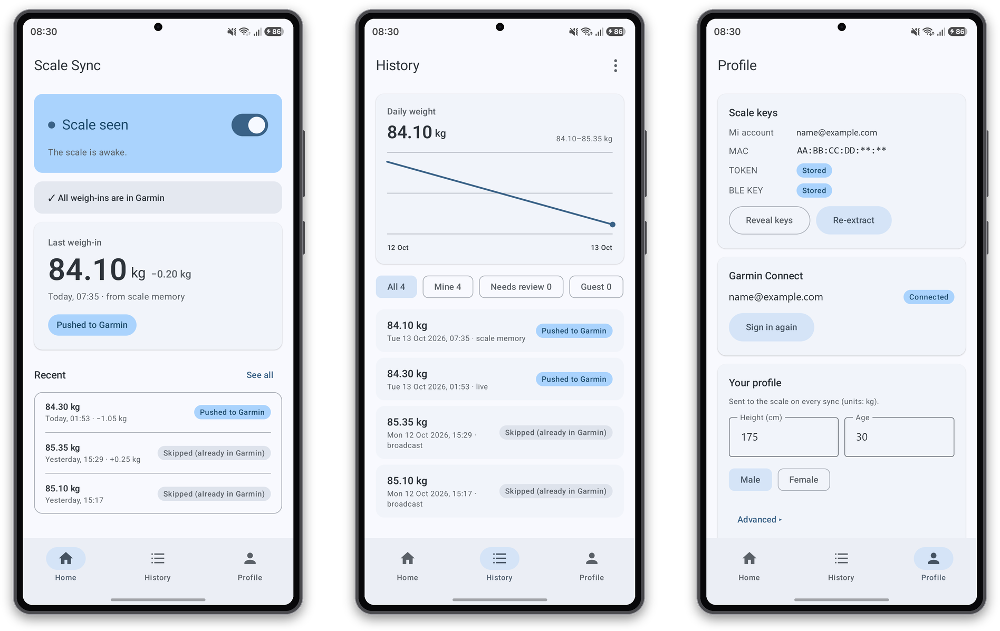

<p align="center">
  
</p>

<h1 align="center">Xiaomi Scale Sync</h1>

An open-source Android app that reads your **Xiaomi Smart Scale S200** over
Bluetooth and sends your weigh-ins to **Garmin Connect**, without duplicates
and without any server in between.

<p align="left">
  <picture>
    <source media="(prefers-color-scheme: dark)" srcset="docs/screenshots/showcase-dark.png">
    
  </picture>
  <br>
  <sub>Home · History · Profile</sub>
</p>

- Captures weigh-ins while the app's **Home** tab is open: from the scale's
  broadcast, live while you stand on it, and from the scale's own memory.
- Pushes each of your weigh-ins to Garmin Connect once. Before every push it
  checks that day's Garmin entries and skips anything already there.
- Keeps a local history with a daily chart, and lets you review weigh-ins the
  scale could not attribute ("Needs review": approve as yours or keep as a
  guest's — guests are never sent to Garmin).
- No background service: it only listens while Home is on screen, and there
  is an on/off switch on Home to stop listening entirely.

**Protocol credit:** Based on the reverse-engineered S200 protocol from
[faraga1/xiaomi-scale-s200-ble](https://github.com/faraga1/xiaomi-scale-s200-ble) (MIT).

## Install

1. Download the latest `xiaomi-scale-sync-vX.Y.Z.apk` from the
   [Releases](../../releases) page.
2. Open it on your phone. Android asks you to allow installing apps from this
   source (your browser or file manager) — allow it once.
3. Requires Android 8.0 or newer and Bluetooth LE.

Updating from a self-built debug APK to a release APK: the two are signed with
different keys, so Android will not install one over the other. Uninstall the
debug build first (this clears the app's data; you will set it up again).

## Setting up

The wizard walks you through five steps:

1. **Scale keys.** Sign in with your Mi account (the one the scale is paired
   to in the Xiaomi Home app). The app asks Xiaomi's cloud for three values
   and shows a green check for each:
   - **MAC** — the scale's Bluetooth address;
   - **TOKEN** (24 hex characters) — used to log in to the scale;
   - **BLE KEY** (32 hex characters) — used to decrypt the scale's broadcasts.

   If Xiaomi asks for a verification code (email/SMS 2FA) or a captcha, the
   app shows a dialog for it. Already have the keys from another tool? Use
   **I already have the keys** and paste them.
2. **Profile.** Height, age and sex (sent to the scale so it can recognise
   you).
3. **History question.** See "Coming from a previous setup" below.
4. **Garmin Connect.** Sign in (with the MFA code if Garmin asks). Only
   Garmin's sign-in tokens are kept; your password is never stored.
5. **Done.** Open Home, allow Bluetooth access, and step on the scale.

Everything can be changed later on the **Profile** tab: re-extract keys,
sign in to Garmin again, edit your profile, or switch between light and dark
appearance.

## Coming from a previous setup

If another tool (for example a script) has already been sending this scale's
weigh-ins to Garmin:

- **Answer "yes" to the history question.** Weigh-ins recorded before you
  installed the app are then archived as *Skipped (already in Garmin)* and
  never pushed. Answer "no" only if Garmin should receive your whole history.
- **The duplicate check protects you either way.** Before each push the app
  looks at Garmin's entries for that day and skips a weigh-in with the same
  time, or the same date and the same weight.
- **Retire the old script** once the app is working, so only one thing
  talks to the scale. Two clients connecting to the scale can fight over it.
- **Member ID:** the app always uses `1`, which is right for almost
  everyone. Only if your old setup used a different
  `XIAOMI_PROFILE_MEMBER_ID`, enter that value under Profile → *Advanced*.
  A wrong value sends your weigh-ins to *Needs review* instead of Garmin.
- **The app never deletes weigh-ins from the scale** (like a `KEEP_ON_SCALE`
  setting). So the scale re-sends its stored weigh-ins on every sync (the app
  ignores the repeats), and after an uncollected weigh-in it keeps asking to
  be collected for about 5 minutes before sleeping. You can clear the scale's
  memory explicitly from History → ⋮ → *Clean scale memory*; it is done at
  the next sync.

## Troubleshooting

- **The scale seems stuck** (its Bluetooth icon stays lit and it is never
  heard): take the batteries out for 10 seconds. Weigh-ins stored on the
  scale survive this. The app also shows a banner after 12 hours of listening
  without hearing the scale.
- **Login to the scale keeps failing:** the TOKEN and the BLE KEY are easy to
  swap — they come from different places and are not interchangeable. The
  TOKEN is 24 hex characters, the BLE KEY 32. Re-extract them on the Profile
  tab, or check the values with *Reveal keys*.
- **"Garmin sign-in expired":** tap the banner's *Sign in* button (or Profile
  → Garmin Connect → *Sign in*). Weigh-ins that waited are pushed afterwards.
- **A weigh-in shows "Needs review":** the scale could not tell who stood on
  it. Open History and choose *Approve as mine* (it is then pushed) or
  *Keep as guest* (it stays in the app only).
- **Nothing happens when I step on the scale:** make sure Home is open, the
  listening switch is on, Bluetooth is on and the app has Bluetooth access.

## Privacy

- All keys, tokens and your history stay **on your phone**. There is no
  server; the app talks only to Xiaomi's cloud (once, to fetch the scale
  keys), to the scale over Bluetooth, and to Garmin Connect.
- Keys and the Garmin token are stored encrypted with a key held in the
  Android Keystore and are excluded from backups. They are never written to
  logs.
- The Bluetooth scan is declared `neverForLocation`: the app does not use
  your location.

## Building from source

Requires JDK 17.

```sh
./gradlew testDebugUnitTest assembleDebug     # tests + debug APK
./gradlew installDebug                        # install on a connected phone
```

The README screenshots are framed with `scripts/frame_screenshots.py`
(needs Pillow): save `<screen>-<theme>.png` captures (screen: `home`,
`history`, `profile`; theme: `light`, `dark`) from
`adb exec-out screencap -p` in a folder and run
`python scripts/frame_screenshots.py <folder> docs/screenshots`.

Releases are built by GitHub Actions when a `v*` tag is pushed
(`.github/workflows/release.yml`). The signing keystore lives only in the
repository's secrets: `RELEASE_KEYSTORE_BASE64`, `RELEASE_KEYSTORE_PASSWORD`,
`RELEASE_KEY_ALIAS`.

## Licence

[MIT](LICENSE)
